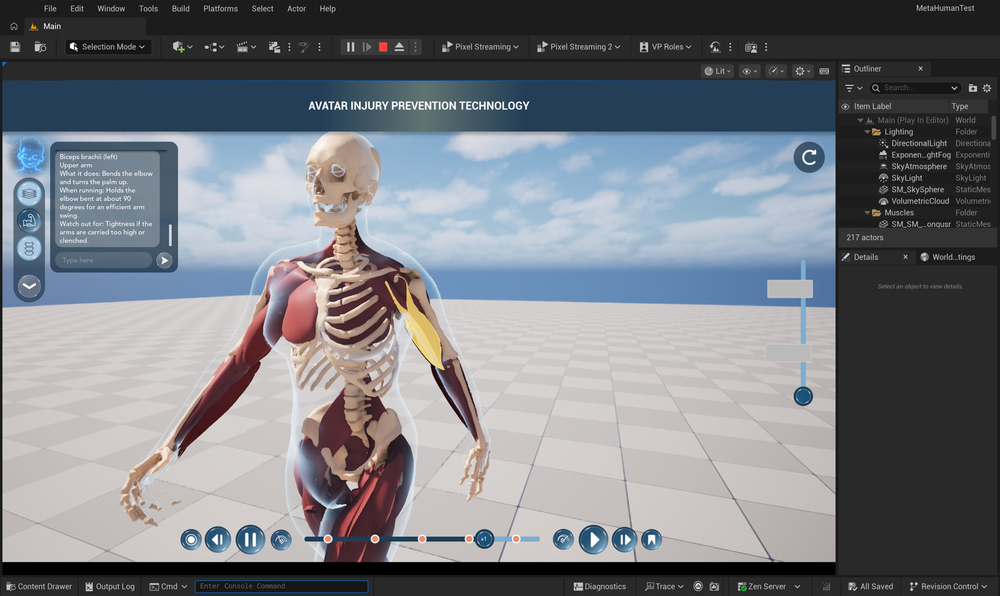
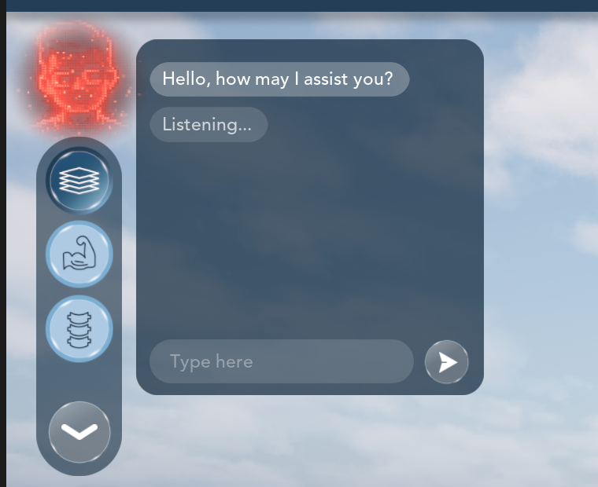
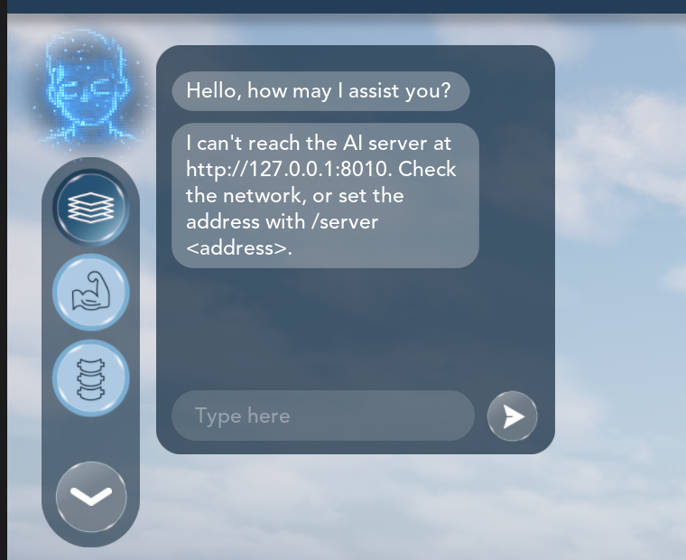

# MHTNewUI AI Assistant — the Unreal side

The BOT in the side bar of the Avatar Injury Prevention app (Unreal Engine 5.8, project `MHTNewUI`) is now an
assistant that does things. Type in its chat box, or hold its logo and talk: it switches the anatomy layer,
drives the timeline and the camera, starts the real-time pose estimation and reads its numbers, and shows any
muscle or bone by name: highlights it, turns the camera to it and writes its description into the chat.

The thinking happens on another computer: an NVIDIA DGX Spark running speech recognition (Whisper), a rule
parser and a local language model (Ollama). The app only sends what was typed or said plus the avatar's state,
and runs the actions that come back. The server is in
[MHTNewUI-AI-Assistant-Server](https://github.com/MatinEsmaeili00/MHTNewUI-AI-Assistant-Server).



```
Unreal (Mac / iPad, anywhere)                      DGX Spark (Louisiana)
  chat box or held BOT logo                          server.py  :8010
        │  POST /v1/chat   {text, context}  ───────►   rules  ──►  LLM (Ollama)
        │  POST /v1/voice  wav + context    ───────►   Whisper ─► rules ─► LLM
        │  ◄───────  {transcript, reply, actions[]}
        ▼
  runs every action on the avatar, then shows `reply` in the chat box
```

## What you can do

| You | The app |
|---|---|
| click the BOT logo | opens / closes the chat (as before) |
| **hold** the BOT logo and talk, then let go | the logo turns red while it records; what you said appears as your bubble, the answer below it |
| type "show the muscles", "now the skeleton" | switches the layer |
| "show me the left biceps", "highlight the femur", "where is the hamstring" | switches to the right layer, highlights the part, turns the camera to it, writes its description |
| "pause", "play it faster", "half speed", "go to the middle" | drives the timeline |
| "zoom in a lot", "look from behind", "reset the view" | moves the camera (it glides) |
| "activate realtime pose estimation and read the data" | opens the Pose Estimation panel, starts the analysis, writes the joint angles into the chat |
| "what is the right knee angle" | answers from the live pose data |
| "make her run" | plays an action clip |
| **click a muscle or bone** with the mouse | its description appears in the chat box (the old popup is off). Works with no server. |
| `/server http://host:8010`, `/key <text>`, `/status`, `/clear`, `/help` | connection settings, in the chat box |

| Hold the logo: recording | Let go: sent |
|---|---|
|  |  |

## Status (2026-11-11)

Built with Unreal 5.8 on a Mac (four builds, all "Succeeded", no warnings in the changed files) and tested in
Play-In-Editor. Details and pictures: [docs/03-build-and-test.md](docs/03-build-and-test.md).

| Tested | Result |
|---|---|
| every action type, run without the server | works; limits and unknown names give a sentence instead of doing nothing |
| typed requests through a local copy of the server (21 requests) | works; server time 0 - 24 ms each |
| hold the logo (pointer events sent through Slate) | red while held, 2.8 s recorded, release does not toggle the chat, a short press still does |
| voice upload | reaches the server as a valid multipart request |
| wrong key, right key, server not running | each gives its own sentence in the chat |

Not tested yet, and why:

- **Speech recognition and the language model.** The Mac has neither Whisper's server-side setup nor Ollama.
  That is the first job on the Spark (see the server repository's `docs/HANDOFF.md`).
- **The link between two cities.** Only `127.0.0.1` so far. See [docs/NETWORK.md](docs/NETWORK.md).
- **A real finger or mouse holding the logo, and a real click on a muscle.** macOS did not let the test tools
  move the mouse. The hold was tested with pointer events sent through Unreal's own UI layer (the same path a
  finger takes); a muscle click ends in the same event that "show me ..." fires, which was tested.
- **iPad, Windows, a packaged build.** Only the Mac editor.

## Read

| Page | |
|---|---|
| [docs/01-what-it-does.md](docs/01-what-it-does.md) | every feature, how it behaves, how to try it in two minutes |
| [docs/02-code.md](docs/02-code.md) | the files, how a request travels, every action, the settings, how to add an action |
| [docs/03-build-and-test.md](docs/03-build-and-test.md) | what was run and what came back |
| [docs/PROTOCOL.md](docs/PROTOCOL.md) | the contract with the server (the same file as in the server repository) |
| [docs/NETWORK.md](docs/NETWORK.md) | reaching the Spark from another city (the same file as in the server repository) |

## What is in this repository

```
unreal/      the changed and new files, with the project's own paths: copy over a MHTNewUI checkout
patches/     the same change as one patch
docs/        the pages above, with pictures
Tools/       the scripts that drove the editor during testing (start Play, type, screenshot, read the log)
```

The project itself lives in Perforce and in the private repository `MetaHumanTest-NewUI-PoseEstimation`. The
change sits on top of the animated BOT logo
([MHTNewUI-AnimatedBotLogo](https://github.com/MatinEsmaeili00/MHTNewUI-AnimatedBotLogo)): the side bar files
here include that work and need its `Plugins/HoloAvatar`.

## Putting it into a project copy

1. Copy `unreal/` over the project folder (or `git apply patches/01-mhtnewui-ai-assistant.patch`).
2. Build with the editor closed:
   ```sh
   "/Users/Shared/Epic Games/UE_5.8/Engine/Build/BatchFiles/Mac/Build.sh" MetaHumanTestEditor Mac Development \
       -Project="<...>/MHTNewUI/MetaHumanTest.uproject" -WaitMutex
   ```
3. Play. In the chat box: `/server http://<the Spark>:8010`, `/key <text>` if the server has one, `/status`.

No asset has to be changed: the assistant is created by the C++ player controller.
