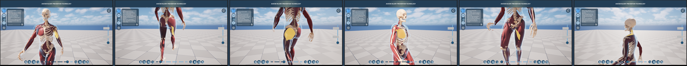
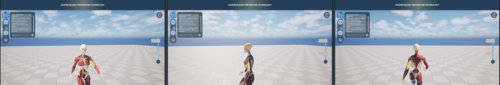
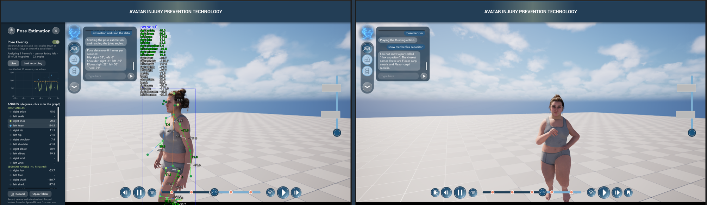

# 01 - What it does

## Try it in two minutes

1. Start the server somewhere (the Spark, or a laptop for a first try: see the server repository's README).
2. Open the project, press Play.
3. Click the BOT logo (top of the side bar). Type `/server http://<address>:8010`, Enter. It answers
   "The AI server answers. ...".
4. Type `show me the left biceps`. The avatar turns into muscles, the left biceps lights up, the camera glides
   in front of it, and the chat shows what the biceps does.
5. Hold the BOT logo, say "look from behind", let go.
6. Click any muscle with the mouse: its description appears in the chat.

## The chat box

- **Enter** (or the round send button) sends the text. Your bubble is on the right, the assistant's on the left.
- While the assistant works there is a fainter line at the bottom: `Listening...` while it records,
  `Thinking...` until the answer is there. The BOT logo follows: it thinks, then talks.
- Requests are answered in the order they were made, one at a time.
- If an action could not be done, the chat says why: "It is already at the fastest speed (x3).",
  "This avatar can't do "flying". It can do: Idle, Running, Jogging, TennisForehand, SoccerWarmup."
- If the server can't be reached, the chat says so with its address. Clicking muscles still works.

Commands that start with a slash are handled by the app, not sent to the server:

| Command | |
|---|---|
| `/server` | shows the server address |
| `/server http://host:8010` | changes it and remembers it on this computer, then asks the server for its status |
| `/server default` | back to the address set in the project |
| `/key <text>` | the key the server wants (`ASSISTANT_API_KEY` on the server). `/key none` removes it |
| `/status` | asks the server whether it is there, and whether its language model and speech recognition are ready |
| `/clear` | empties the chat and starts a new conversation on the server |
| `/do <action> key=value ...` | runs one action directly, without the server (for testing): `/do camera op=view value=back` |
| `/help` | examples |

## Talking: hold the BOT logo

- A short press is a click: the chat opens or closes, as before.
- Holding the logo for 0.3 s starts recording. The logo turns **red** and grows a little, the chat opens and
  shows `Listening...`. Ripples on the logo follow your voice.
- Let go: the recording is sent. What was understood appears as your bubble, then the answer.
- A recording stops by itself after 15 s. One shorter than 0.4 s is thrown away ("Keep my logo held while you
  speak, then let go.").
- If the microphone gives only silence the app says so, with where to allow it (on a Mac: System Settings,
  Privacy & Security, Microphone). The first recording makes macOS ask for permission.
- Works with the still picture too (Animated Bot off): the picture is tinted red.

## Muscles and bones

**By name.** "show me the left biceps", "highlight the femur", "where is the hamstring", "the right
quadriceps", "the left shoulder blade". The server maps everyday names to the avatar's atlas names (hamstring
to Biceps femoris (long head), quadriceps to Rectus femoris, shoulder blade to Scapula) and says which one it
picked. The app then:

1. switches to the layer the part is on (muscles or skeleton), with the side bar's button following;
2. highlights the part (the same yellow glow as a click);
3. glides the camera to the side the part is on: the biceps from the front, the hamstrings from behind, the
   inner-thigh muscles from the front, a bone from the front turned to its side of the body;
4. writes the description into the chat.

With no side given ("show me the biceps") the side nearer to the camera is used.



Left to right: left biceps, right hamstring (Biceps femoris), left Gluteus maximus, right Pectoralis major,
left Adductor longus, left upper Trapezius.

**By click.** A click on a muscle or bone (in the muscle or skeleton layer) highlights it as before. Its
description now goes into the chat box, which opens if it was closed. The popup window of `WB_MuscleInfo` no
longer appears; the small name label that follows the mouse while hovering is unchanged. A description:

```
Biceps brachii (left)
Upper arm
What it does: Bends the elbow and turns the palm up.
When running: Holds the elbow bent at about 90 degrees for an efficient arm swing.
Watch out for: Tightness if the arms are carried too high or clenched.
```

The avatar knows 214 names: 93 muscles and ligaments and 121 bones, most of them on both sides.

## Timeline, camera, layers, pose estimation, clips, panels

Everything the buttons can do, by name. The full list with every option is the Actions section of
[PROTOCOL.md](PROTOCOL.md).

| Say | Does |
|---|---|
| show the muscles / the skeleton / the body | the layer buttons |
| play, pause, restart | the play / pause / restart buttons |
| faster, slower, half speed, double speed | the speed steps of the timeline bar (x0.25 ... x3) |
| go to the middle, go to 30 percent | scrubs |
| bookmark this, start recording, stop recording | the bookmark and record buttons |
| zoom in, zoom out a lot | each step is a quarter closer |
| look from the front / behind / the left / the right / above | the camera glides there |
| turn the camera 45 degrees | orbits |
| reset the view | the round arrow button |
| start the pose estimation | opens the Pose Estimation panel, the overlay and the analysis |
| read the data | writes the joint angles into the chat |
| what is the right knee angle | answered from the live numbers |
| make her run / jog / idle | the action cards |
| open the graphs, close the panel | the side panels |
| next avatar | the next character |



"Look from the front", "from the left", "from behind". Left means the avatar's own left side.



## Without the server

- Clicking muscles and bones, and their descriptions in the chat: works.
- `/do ...` and the console command `Assistant.Do ...`: work.
- Typing a request: "I can't reach the AI server at ... Check the network, or set the address with /server".
