# 03 - Build and test

What was run on 2026-11-11, in order, and what came back. Mac, Unreal Engine 5.8, Metal, level `Main`,
avatar `BP_MH_CH_Abby8` (and `Beau` for the avatar switch).

## Build

With the editor closed:

```sh
"/Users/Shared/Epic Games/UE_5.8/Engine/Build/BatchFiles/Mac/Build.sh" MetaHumanTestEditor Mac Development \
    -Project="<...>/MHTNewUI/MetaHumanTest.uproject" -WaitMutex
```

| Build | What changed since the last one | Result | Time |
|---|---|---|---|
| 1 | everything: assistant component, camera glides, chat status line, hold-to-talk, picker functions | Succeeded | 30 s |
| 2 | which side to look at a part from (limb lines instead of sample offsets); `/do` | Succeeded | 17 s |
| 3 | `SimulateBotHold` / `Assistant.HoldLogo` | Succeeded | 16 s |
| 4 | console address guard; pose-data header | Succeeded | 16 s |
| 5 | the glow follows the layer with no pointer over the view; `seek` stops at 0.999 | Succeeded | 11 s |

No errors, and no warnings in the changed files, in any of the five.

## How the running editor was driven

The editor's MCP server answers on `127.0.0.1:8002`. It was called over HTTP with the scripts in
[`Tools/`](../Tools): `t.sh pie` (start Play), `t.sh con "<console command>"` (types into the editor's console
box), `t.sh type <ref> "<text>"` (types into the chat box), `t.sh shot <name>` (screenshot of the window),
`t.sh alog <pattern>` (the assistant's log lines). `rebuild.sh` stops Play, closes the editor, builds and
starts it again.

## Test 1 - start-up

Log at Begin Play:

```
Assistant ready. Server: http://127.0.0.1:8010 (no key). Session 6900...
Catalog fb03245fda39: 214 names (386 muscle / bone entries) from 2 picker(s) on BP_MH_CH_Abby8_C_0
Warning: AI server not reachable at http://127.0.0.1:8010 (HTTP 0)
```

214 names is 93 muscles and ligaments plus 121 bones, the same as the atlases
`DA_Atlas_Muscles_Segmented` and `DA_Atlas_Skeleton_Segmented` read directly from the editor.

## Test 2 - every action, without a server

Each line was typed into the console as `Assistant.Do ...`; the result is the component's log line.

| Command | Result |
|---|---|
| `set_layer layer=muscles` | ok; muscles shown, the side bar's button follows |
| `show_part kind=muscle name=Biceps_brachii side=left` | ok; highlighted, description in the chat |
| `timeline op=pause` / `op=play` / `op=seek value=0.5` / `op=bookmark` | ok |
| `timeline op=faster`, then `op=faster value=5`, then `op=faster` | ok, ok, **"It is already at the fastest speed (x3)."** |
| `timeline op=set_speed value=0.5` | ok; the bar's knob shows x0.5 |
| `timeline op=record_stop` (nothing recording) | **"Nothing is being recorded."** |
| `camera op=zoom_in value=2`, `value=12`, then `op=zoom_in` | ok, ok, **"The camera is already as close as it goes."** |
| `camera op=zoom_out value=3`, `op=orbit yaw=45`, `op=reset` | ok |
| `camera op=view value=front` / `left` / `back` | ok (picture below) |
| `play_action name=running` | ok; the avatar runs |
| `play_action name=flying` | **"This avatar can't do "flying". It can do: Idle, Running, Jogging, TennisForehand, SoccerWarmup."** |
| `open_panel panel=graphs`, `panel=none` | ok |
| `show_part kind=bone name=femur` | ok; skeleton layer, femur highlighted |
| `clear_selection`, `set_layer layer=body` | ok |
| `bogus_action` | **"This version of the app does not know the action "bogus_action"."** |
| `pose_estimation enabled=true`, `read_pose_data` | ok; the panel opens, the angles are written into the chat |
| `pose_estimation enabled=false` | ok; the panel closes |
| `switch_avatar direction=next`, `direction=previous` | ok; Beau, then Abby again; the chat keeps its messages |

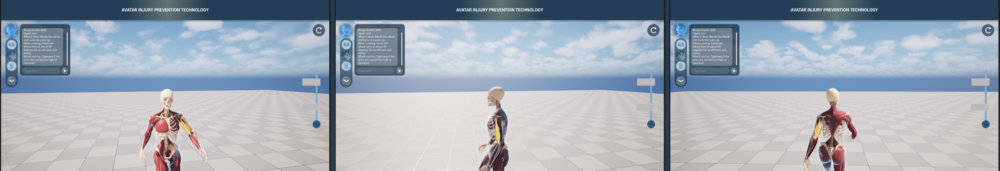

The yellow muscle is the selected left biceps: on the avatar's left arm in the front view, on the near arm in
the left view.

## Test 3 - which side to look from

First version: the camera went to the wrong side for the left biceps (below: the camera is on the avatar's
right; the cyan muscle is only the mouse hovering).

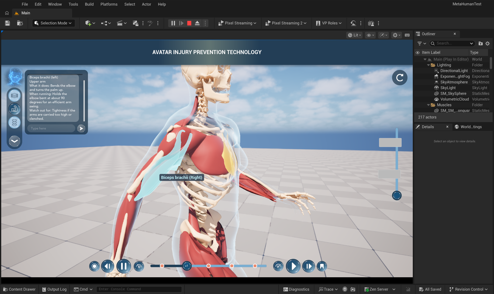

Cause: the direction was computed from the picking samples' offsets from "their" bone, and the muscle mesh is
skinned to helper bones that sit on the muscles. Second version (`PickViewSide`, see [02-code.md](02-code.md)):

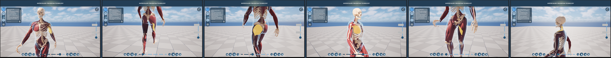

Left biceps from the front; right hamstring from behind; left Gluteus maximus from behind; right Pectoralis
major from the front right; left Adductor longus from the front (not from between the legs); left upper
Trapezius from behind.

## Test 4 - hold the logo

macOS did not allow the test tools to press the real mouse ("trusted for accessibility: false"), so the press
was sent through Slate itself (`Assistant.HoldLogo`, which calls `SimulateBotHold`: mouse-down on the button,
a timer, mouse-up). The button receives the same events as from a finger.

| Command | Result |
|---|---|
| `Assistant.HoldLogo 3` | after 0.3 s the logo is red and the chat shows "Listening..."; on release the log says `Microphone: 2.79 s recorded, 268332 bytes`; the chat stays open (the release was not taken as a click) |
| `Assistant.HoldLogo 0.1` | a click: the chat closes |
| `Assistant.Talk 1` ... `Assistant.Talk 0` | the same recording path without the button: `3.71 s recorded, 356396 bytes` |

| Held | Released (no server running) |
|---|---|
| 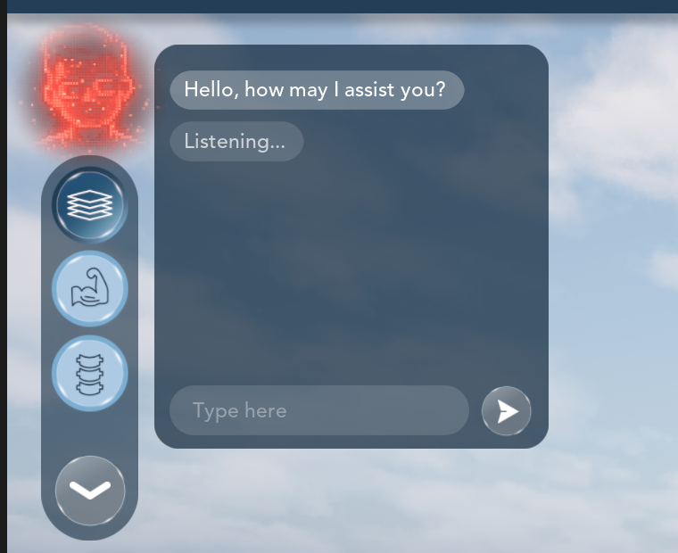 | 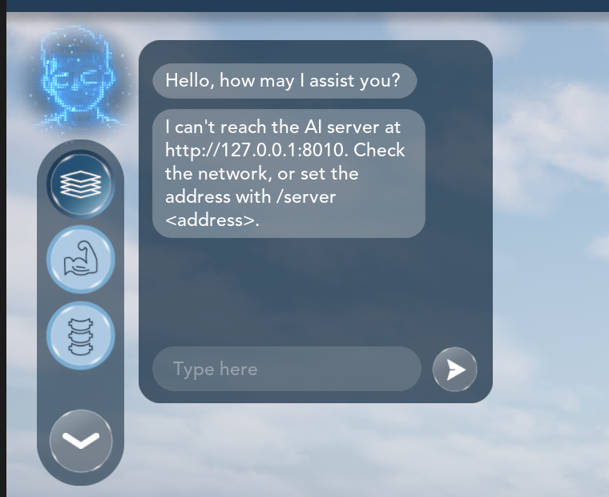 |

The microphone opened without a prompt on this Mac (the editor already had permission). The loudest sample was
0.004 - 0.010: room noise, nobody was speaking.

## Test 5 - through the server, on one machine

The server ran on the same Mac, on `127.0.0.1:8011` (no Ollama on this Mac; speech recognition was added for Test 7).
Requests were made with `Assistant.Ask <text>` and by typing into the chat box. From the log:

```
The AI server answers. Language model gemma4:e4b: not ready (direct commands still work). Speech recognition base.en: not ready (typing still works).
<- [rules 12 ms] heard "switch to the muscle layer" | 1 action(s), 0 failed | "Showing the muscle layer."
<- [rules 1 ms] heard "show me the left biceps" | 1 action(s), 0 failed | "Here is the left Biceps brachii."
<- [rules 0 ms] heard "pause" | 1 action(s), 0 failed | "Paused."
<- [rules 0 ms] heard "play it faster" | 2 action(s), 0 failed | "Playing faster."
<- [rules 0 ms] heard "zoom in a lot" | 1 action(s), 0 failed | "Zooming in a lot."
<- [rules 0 ms] heard "show me the hamstring" | 1 action(s), 0 failed | "For the hamstring I am showing the Biceps femoris (long head)."
<- [rules 0 ms] heard "highlight the femur" | 1 action(s), 0 failed | "Here is the Femur."
<- [error 24 ms] heard "what does the deltoid do" | 0 action(s), 0 failed | "The language model is not answering right now, but the direct commands still work. ..."
<- [rules 0 ms] heard "reset the view and show the body" | 2 action(s), 0 failed | "Camera reset. Showing the body layer."
<- [rules 0 ms] heard "activate realtime pose estimation and read the data" | 2 action(s), 0 failed | "Starting the pose estimation and reading the joint angles."
<- [rules 1 ms] heard "what is the right knee angle" | 0 action(s), 0 failed | "The right knee is at 52 degrees."
<- [rules 0 ms] heard "stop pose estimation" | 1 action(s), 0 failed | "Stopping the pose estimation."
<- [rules 0 ms] heard "make her run" | 1 action(s), 0 failed | "Playing the Running action."
<- [rules 19 ms] heard "show me the flux capacitor" | 0 action(s), 0 failed | "I do not know a part called "flux capacitor". The closest names I have are Flexor carpi ulnaris and Flexor carpi radialis."
```

The times are the server's own; the app adds the HTTP round trip on the same machine.

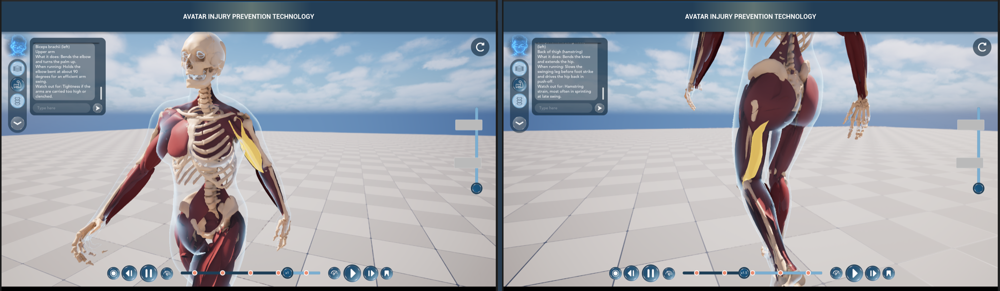

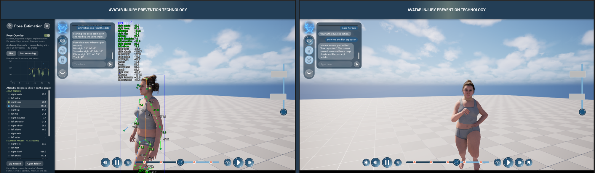

Typed into the chat box itself: `/status`, `/help`, "show me the muscles", "where is the right quadriceps",
`/do camera op=view value=back`, "now the skeleton", "show the left shoulder blade", "go to the middle and
pause", `/server`. All answered as expected:

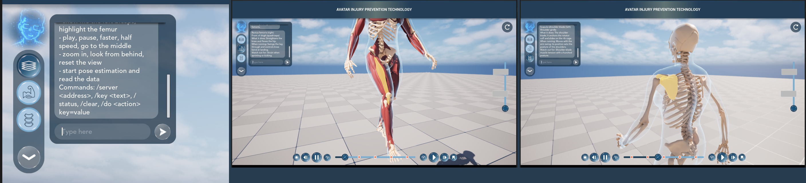

## Test 6 - keys, errors, voice upload

| Case | Result |
|---|---|
| server started with `ASSISTANT_API_KEY`, app has no key | HTTP 401; chat: "The AI server did not accept my key. Set it with /key <text>." |
| the same, after `Assistant.Key <the key>` | answered normally |
| no server running | chat: "I can't reach the AI server at http://127.0.0.1:8010. Check the network, or set the address with /server <address>." |
| a recording uploaded to the server without speech recognition | the multipart request is accepted and parsed; HTTP 503 "Speech recognition is not installed on this server"; the chat shows that sentence |

## Test 7 - spoken requests through the whole chain

The server was restarted with faster-whisper (`base.en`, CPU). Three clips were made with macOS `say`
(16-bit mono, 48 kHz: the format the app records) and sent by the app itself with `Assistant.SendWav <file>`,
which uploads them exactly as a microphone recording is uploaded.

```
-> http://127.0.0.1:8011/v1/voice (162184 bytes of audio)
<- the server asked for the catalog; repeating "Show me the right hamstring." with it
<- [rules 7 ms] heard "Show me the right hamstring." | 1 action(s), 0 failed | "For the hamstring I am showing the right Biceps femoris (long head)."
-> http://127.0.0.1:8011/v1/voice (198302 bytes of audio)
<- [rules 286 ms] heard "Switch to the skeleton and zoom out." | 2 action(s), 0 failed | "Showing the skeleton layer. Zooming out."
-> http://127.0.0.1:8011/v1/voice (302474 bytes of audio)
<- [rules 301 ms] heard "Activate real-time pose estimation and read the data." | 2 action(s), 0 failed | "Starting the pose estimation and reading the joint angles."
```

The first clip also exercised the `need_catalog` repeat over real HTTP: the freshly started server did not
know the avatar's names, asked, and got the same words again as text with the catalog (the clip was not
uploaded twice). The two later times include Whisper.

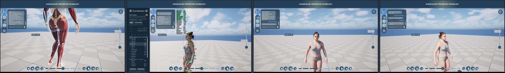

"Rotate left" from the front view: the camera moves to its left (we see more of the avatar's right side),
as the protocol says.

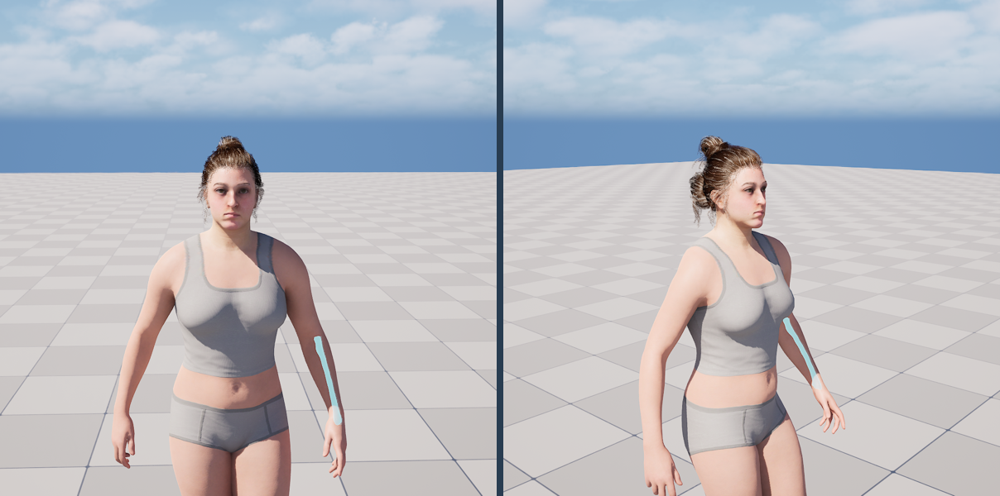

## Test 8 - two fixes from the tests above

- **"Go to the end" went to the start**: the animation loops, so position 1 wraps to 0. `seek` now stops at
  0.999. Checked: the timeline knob is at the right end (last picture below).
- **A highlight stayed on screen in the body layer** when the layer was changed by the assistant while the
  mouse was outside the game view (the pickers only re-checked their glow on a mouse update). With the fix:
  the biceps is highlighted, "show the body" hides the glow, "show the muscles" brings it back, with the mouse
  parked outside the view the whole time.

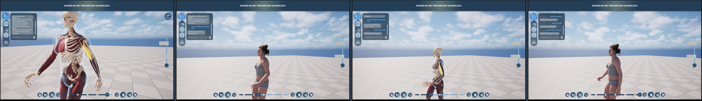

## Test 9 - against the DGX Spark, over Tailscale

Later the same day the server ran on the Spark as a service (language model `gemma4:12b`, Whisper `base.en`,
key required) and this Mac joined the same Tailscale network. The Spark is `spark-99eb` there.

```
curl http://spark-99eb:8010/health   ->  {"status":"ok", ... "auth_required":true,"llm_model":"gemma4:12b","llm_ready":true,"stt_model":"base.en","stt_ready":true}
tailscale ping spark-99eb            ->  pong ... in 4ms (direct path)
```

Both machines were in the same city for this test; the link between two cities is still to be measured.

In the app: `Assistant.Server spark-99eb:8010`, then `/key <text>` typed once by the user (both are remembered
in `GameUserSettings.ini`). Without the key the chat said "The AI server did not accept my key."

25 requests from the app, all answered and all actions run. Round trip = from the app sending to the answer
arriving, read from the log's time stamps.

| Request | How | Answered by | Round trip |
|---|---|---|---|
| 15 direct commands (layers, biceps, hamstring, femur, timeline, camera, run, pose estimation on + read, knee angle, off) | typed | rules | about 20 ms |
| "what does the deltoid do" | typed | language model | 1.9 s |
| "hello, what can you do" | typed | language model | 2.4 s |
| "which muscles work the hardest when running" | typed | language model | 2.3 s |
| "can you make the avatar bigger" | typed | language model: "I cannot change the size of the avatar, but I can zoom the camera in", and it zoomed in | 2.2 s |
| "show me the muscles and then tell me what the soleus is for" | typed | language model: switched the layer and answered | 2.3 s |
| "show me the right hamstring" | spoken (synthetic clip) | Whisper + rules | 0.46 s |
| "show me the left quadriceps and zoom in" | spoken | Whisper + rules, two actions | 0.63 s |
| "what does the gluteus maximus do when I run" | spoken | Whisper + language model | 3.0 s |
| "activate real time pose estimation and read the data" | spoken | Whisper + rules | 0.69 s |

The language-model answers were two sentences each, as asked for, with no markdown.

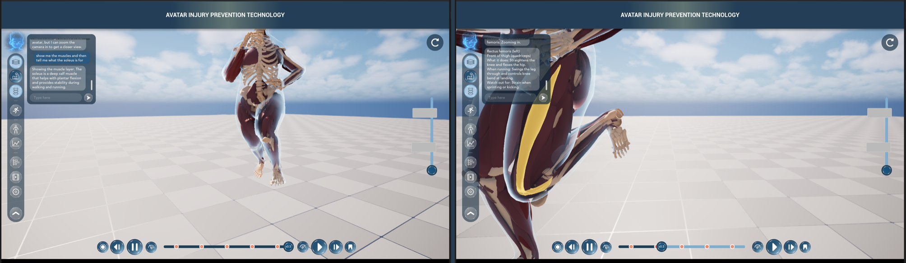

## A trap found on the way

`Assistant.Server http://127.0.0.1:8011` in the **console** set the address to `http:`: the Unreal console
reads `//` as the start of a comment. The console command now refuses `http:` and says to give `host:port`
(the scheme is added). `/server http://...` in the chat box never had the problem.

## Not tested

- **The language model**: no Ollama on this Mac. First job on the Spark.
- **Real voices**: speech was synthetic and sent as files; the microphone recorded only room noise.
- **Any network but `127.0.0.1`.**
- **A real finger / mouse on the logo, a real click on a muscle** (see Test 4; a click fires the same
  `OnSelectionChanged` that Test 2's `show_part` fires).
- **iPad, Windows, a packaged build.** On a packaged Mac / iOS app plain `http://` may be refused by the
  system (the editor's own Info.plist allows it); `https://` through `tailscale serve` avoids the question.
  iOS also needs `NSMicrophoneUsageDescription`.
- **Long sessions**: the chat keeps every bubble; nothing trims it.
